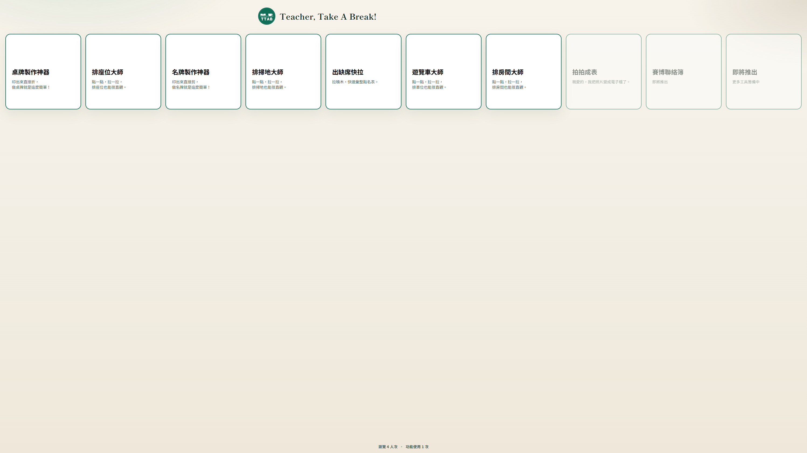

# TTAB — Teacher, Take A Break!

給國中小老師用的一站式課堂小工具：上傳 Excel 名冊後，就能做桌牌、名牌、排座位、排掃地、出缺席、遊覽車與分房。

**Demo：** [https://ttab-tau.vercel.app](https://ttab-tau.vercel.app)

---

## 解決了什麼痛點

在實習期間到正式進入教學現場，明白老師在教學之外，其實還要處理相當多的事務，簡單來說就是教師+保母+活動策劃+清潔隊+法官+行政人員+諮商師+營養師+護理師的集合體。除此之外，我也發現許多年紀較大的老師們，相較於成長在數位世代的我來說，在資訊設備及軟體的使用上比較生疏，因此時常要花費許多時間處理與整理文書方面的資料。

雖說目前已經有許多方便的線上工具及平台可以使用，但各自分散在不同網站服務，且使用上的學習成本也較高。因此我針對一些常見但花費時間的工作進行整理，開發了 TTAB（Teacher, Take A Break!）這個 side project，希望可以透過極致簡便及高度集成的使用體驗，讓教師群體減少繁雜事項的時間花費，空出時間來忙裡偷閒。

---

## 技術棧（Tech Stack）

| 層級 | 技術 |
| --- | --- |
| 前端 | React 19、TypeScript、Vite 6 |
| 檔案處理 | ExcelJS、SheetJS（xlsx） |
| 輸出 | html2canvas、jsPDF（畫面／PDF 輸出） |
| OCR（實驗中） | Tesseract.js（拍拍成表） |
| 後端／資料庫 | 無（純前端，資料留在瀏覽器端處理） |
| 部署 | Vercel |

---

## 核心功能與技術亮點

- **名冊一次匯入，多工具共用**  
  辨識座號、姓名、學號；沒有標題列時可依儲存格內容補欄位。`.xlsx` 有大小與列欄上限，損毀或解壓超限會明確失敗。

- **七項主力工具**  
  桌牌製作神器、名牌製作神器、排座位大師、排掃地大師、出缺席快拉、遊覽車大師、排房間大師；互動以點擊／拖曳為主，並支援預覽與匯出。

- **排座位：教室格局 × 拖曳邏輯**  
  教室格局／小組單位／座位布局選擇、座位數判定、點擊開門、預渲染座位表與卡片拖曳。

- **出缺席快拉：積木式封裝**  
  以積木卡片整理點名狀態，支援範圍、多選與「到」的互動邏輯。

- **前端資安與惡意 xlsx 測試**  
  專案不接後端 API，重點防範前端常見風險（XSS、公式注入、原型汙染、ReDoS、壓縮炸彈、CSP／SRI 等），並備有系統性 xlsx 攻擊測試檔案集（baseline、xss、formula injection、huge rows、zip bomb…）。

- **RWD**  
  桌面橫／直向已支援；手機與平板介面持續補齊中。
